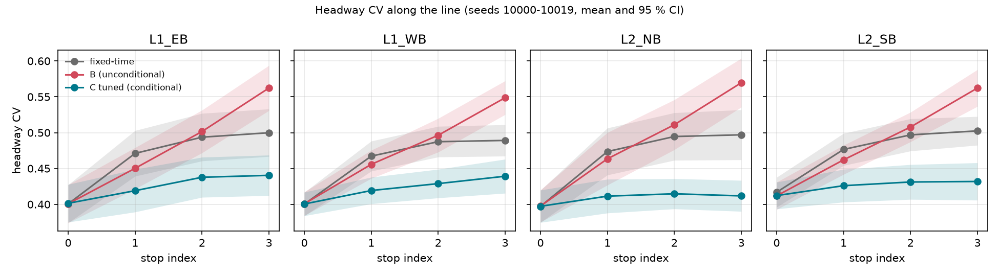

# BO4 – Bus priority for reliability (3x3 grid, SUMO)

## Goal
BO4 aims to make buses **more reliable**: regular headways and less **bunching** (two buses of the same line arriving close together).

Bunching grows by itself along a line:
- **Dwell grows with the gap.** A bus that falls behind finds more waiting passengers, dwells longer and falls further behind.
  The bus behind it finds fewer passengers and catches up.
- **Signals add delay to late buses.** A red light hits a bus at random, and a bus that is already late gets later.

Bus priority at the signals can help a late bus recover. If it is given to every bus, it can also make early buses earlier.

## Scenario
- **Network:** 3x3 grid of signalized junctions `A0..C2`, 300 m blocks, 2 lanes per direction, 13.89 m/s, a left-turn lane on every approach (`nets/grid/`).
- **Bus lines:**
  - L1 runs E-W on the middle row (`L1_EB`, `L1_WB`); L2 runs N-S on the middle column (`L2_NB`, `L2_SB`). They cross at `B1`.
  - Headway H = 180 s, dispatch jitter σ = 60 s, occupancy 20–60 passengers per bus.
- **Stops:** 4 per direction: one on the entry link, then one far-side stop about 100 m after each of the 3 junctions.
  Every stop-to-stop segment crosses exactly one junction.
- **Closed-loop dwell at every stop:**
  - `dwell = 10 + 2.5·B` s, with `B ~ Poisson(λ·gap)`, where `gap` is the time since the previous bus of the same direction.
  - This gives a mean of 25 s at gap = H, so dwell grows with the gap.
- **Car demand:** 675 veh/h per entry on each of the 12 fringe entries (Poisson), 60 % straight across. This is the highest calibrated flow without gridlock.
- **Team signal timing:**
  - Fixed-time cycle 75 s: E-W green 35 s, N-S green 30 s, yellow 3 s, all-red 2 s.
  - Any green stays within 10–60 s.
- **Seeds:**
  - Training seeds are 0–999. This study used 0–9 for tuning and 0–4 for the stress test.
  - Evaluation seeds are 10000+. The final evaluation used 10000–10019.
- **Run settings:** warm-up 600 s, then a 7200 s measurement window. Every result comes from a headless **libsumo** run (SUMO 1.28.0); each CSV has a `backend` column.

All modelling choices are documented in [`ASSUMPTIONS.md`](ASSUMPTIONS.md).

## Controllers (`rule_tsp.py`)
There is one controller per junction. Priority only changes the remaining time of the current green, so yellow and all-red are never touched, and every green stays within 10–60 s.
- **Green extension:** the bus's phase is green, but the bus would not clear before the green ends. The green is extended, by at most MAX_EXT seconds per cycle.
- **Early recall:** the bus waits on red. The conflicting green is shortened, never below 10 s, so the bus phase comes sooner.

After a priority action, the junction returns to its normal fixed-time cycle.

| controller | rule |
|---|---|
| **fixed** | the fixed-time program, no priority |
| **B** (unconditional) | every bus detected within 150 m of the stop line gets priority |
| **C** (conditional) | only **late** buses (time since the previous bus of the same line passed this junction − H > L) |
| | **queue rule:** refused if a queue on the approaches that would lose green exceeds Q vehicles |
| | **conflict rule:** when buses ask for both directions, the later bus wins (tie: higher occupancy) |

- **C_default:** L = 0 s, Q = 15 veh, MAX_EXT = 15 s.
- **C_tuned:** L = 0 s, Q = 15 veh, MAX_EXT = 20 s.

## Metrics (`bus_metrics.py`, `Grid_Demo.py`)
- **Bus delay per junction:** time from one stop to the next minus the free-flow time.
- **Headway CV per stop:** standard deviation of headways / mean, at each of the 4 stops.
- **Bunching at the last stop:** headways shorter than 0.5 H (90 s) at the last stop, summed over the 4 line directions.
- **Car delay:** mean `timeLoss + departDelay` per car.
- **Cross-street delay:** mean car delay per approach passage on the 24 approaches **not** on a bus line. It shows who pays for priority.
- **Person delay:** total delay of bus passengers and car occupants (1.3 per car), in person-hours.

## Results – final evaluation (seeds 10000–10019)
Each value is the mean ± 95 % CI half-width over 20 seeds (from `results/c_final_summary.csv`).

| metric | fixed | B | C_default | C_tuned |
|---|---|---|---|---|
| bus junction delay (s) | 27.7 ± 0.3 | 15.1 ± 0.7 | 22.2 ± 0.3 | 21.9 ± 0.3 |
| bus travel time (s) | 281.1 ± 1.0 | 242.8 ± 2.2 | 264.2 ± 1.1 | 263.1 ± 1.1 |
| last-stop bunching | 35.8 ± 1.9 | 33.6 ± 1.7 | 27.7 ± 1.5 | 27.6 ± 1.9 |
| total bunching | 119.8 ± 6.9 | 101.0 ± 6.1 | 95.7 ± 6.2 | 96.5 ± 6.5 |
| last-stop headway CV | 0.50 ± 0.01 | 0.56 ± 0.01 | 0.43 ± 0.01 | 0.43 ± 0.01 |
| car delay (s) | 72.6 ± 5.6 | 77.2 ± 11.7 | 70.9 ± 3.2 | 68.8 ± 0.7 |
| cross-street delay (s) | 21.8 ± 1.6 | 24.8 ± 3.9 | 21.8 ± 1.0 | 21.2 ± 0.2 |
| bus-line approach car delay (s) | 22.2 ± 1.9 | 19.6 ± 2.2 | 20.0 ± 0.7 | 19.4 ± 0.2 |
| person delay (h) | 561 ± 34 | 524 ± 71 | 524 ± 20 | 510 ± 5 |
| never inserted | 3.1 ± 6.4 | 18.1 ± 36.7 | 0.05 ± 0.10 | 0.05 ± 0.10 |
| teleports | 0.05 ± 0.10 | 0.7 ± 1.5 | 0 | 0 |
| TSP requests / granted | – | 448 / 429 | 530 / 195 | 526 / 197 |
| refused by queue rule | – | 0 | 0.7 | 0.45 |

**Paired difference vs fixed-time** (same seeds, mean ± 95 % CI):

| | last-stop bunching | car delay (s) | cross-street delay (s) | bus junction delay (s) |
|---|---|---|---|---|
| B | −2.2 ± 2.1 | +4.6 ± 13.2 | +3.0 ± 4.3 | −12.7 ± 0.7 |
| C_default | −8.1 ± 1.6 | −1.7 ± 5.1 | −0.1 ± 1.5 | −5.5 ± 0.4 |
| C_tuned | −8.2 ± 1.8 | −3.9 ± 5.5 | −0.6 ± 1.6 | −5.9 ± 0.4 |

The car-delay CIs of fixed and B are wide because of single breakdown seeds: fixed on seed 10009 (61 never inserted), and B on seeds 10001 (351) and 10018 (10).



*Headway CV by stop index, one panel per line direction (mean and 95 % CI, 20 seeds). With C, CV stays nearly flat along the line; it grows with fixed-time, and fastest with B.*

## Tuning and stress test
**Tuning** used training seeds 0–9 (`results/c_tuning_summary.csv`).
- The grid search covered L ∈ {0, 20, 40} s × Q ∈ {8, 12, 15} veh × MAX_EXT ∈ {10, 15, 20} s.
- The objective was to minimise last-stop bunching, with car delay at most 3 % above fixed-time (75.1 s; fixed-time last-stop bunching 34.1).

| rank | setting | last-stop bunching | car delay vs fixed | bus junction delay |
|---|---|---|---|---|
| 1 | L 0, Q 12, E 20 | 27.7 | −3.6 % | 22.3 s |
| 2 | L 0, Q 15, E 15 (= C_default) | 28.0 | −8.1 % | 22.2 s |
| 3 | **L 0, Q 15, E 20 (chosen)** | 28.2 | −6.5 % | 22.1 s |
| 4 | L 0, Q 15, E 10 | 29.1 | −8.8 % | 22.4 s |
| 5 | L 0, Q 8, E 15 | 29.1 | −9.2 % | 22.7 s |

- The top 3 are within 0.5 bunched headways, while each setting's standard error is about 1, so they are tied.
- Rank 3 was chosen over rank 1 because rank 1 broke down on training seed 3 (55 never inserted). The chosen setting has no breakdown on any training seed and the lowest bus delay of the three.
- Every L = 0 setting beats every L = 20 and L = 40 setting.

**Stress test** used training seeds 0–4 (`results/c_stress_summary.csv`):

| flow (veh/h) | controller | bus junction delay (s) | last-stop bunching | car delay (s) | cross-street delay (s) | never inserted | teleports | refused by queue rule |
|---|---|---|---|---|---|---|---|---|
| 600 | fixed | 27.3 | 38.4 | 63.5 | 19.0 | 0.2 | 0.0 | – |
| 600 | B | 14.6 | 34.2 | 62.9 | 19.9 | 0.2 | 0.0 | 0.0 |
| 600 | C_tuned | 20.7 | 30.6 | 61.9 | 18.9 | 0.2 | 0.0 | 0.0 |
| 675 | fixed | 28.6 | 35.4 | 80.3 | 23.9 | 10.0 | 0.2 | – |
| 675 | B | 15.5 | 34.4 | 94.9 | 29.6 | 35.8 | 1.6 | 0.0 |
| 675 | C_tuned | 22.4 | 28.0 | 72.4 | 22.4 | 0.0 | 0.0 | 2.4 |
| 725 | fixed | 31.7 | 36.6 | 124.5 | 36.0 | 207.6 | 3.8 | – |
| 725 | B | 19.3 | 34.2 | 164.7 | 52.0 | 486.0 | 15.0 | 0.0 |
| 725 | C_tuned | 28.1 | 34.4 | 165.0 | 43.3 | 401.0 | 8.2 | 26.6 |

- Queue-rule refusals rise with demand.
- At 725 veh/h, C keeps cross-street delay below B (43.3 vs 52.0 s). But every controller breaks down there, and C is worse than fixed-time.

## Findings
- **C cuts bunching without costing cars.** Versus fixed-time, last-stop bunching falls by 8.2 ± 1.8 (C_tuned) and the last-stop headway CV drops from 0.50 to 0.43. Car delay (−3.9 ± 5.5 s) and cross-street delay (−0.6 ± 1.6 s) do not get worse.
- **B makes buses faster but less regular.** It has the lowest bus junction delay (−12.7 ± 0.7 s vs fixed-time), but the highest last-stop headway CV (0.56), because it also speeds up buses that are already early. It also caused a breakdown on one evaluation seed.
- **Lateness is what matters.** Giving priority only to late buses (L = 0) is what reduces bunching. Higher lateness thresholds (20, 40 s) grant too few requests.
- **Tuning made no difference.** C_tuned and C_default are indistinguishable on every metric.
- **Above capacity, no rule helps.** At 725 veh/h every controller gridlocks. The queue rule protects cross streets relative to B, but cannot prevent the breakdown.

## Limits and future work
- **Simulated passengers:** occupancy and boardings are simulated (uniform occupancy, Poisson boardings), not observed data.
- **Standalone prototype:** this runs outside the team platform. The decision logic (`decide()` in `rule_tsp.py`) is a pure function of plain data and is unit-tested without SUMO, so that it can be ported.
- **Next step:** port the controller to `flowmind/specialists/bus`, on the team's `JunctionState` contract.
- **Reinforcement learning:** train an RL controller and test whether it beats C, which is the baseline to beat.

## How to reproduce
Use the venv Python that has libsumo (SUMO 1.28.0). The system Python falls back to traci, and its results are not valid.

```bash
PY=/c/Users/Jmbo2/SUMO-RL/.venv/Scripts/python.exe

# tests
$PY -m pytest -q bo4_bus/tests

# step 3 runs, seeds 10000-10004 (results/grid_fixed_time*.csv, grid_tsp_all*.csv, grid_tsp_cond*.csv)
$PY bo4_bus/Grid_Demo.py --controller fixed
$PY bo4_bus/Grid_Demo.py --controller tsp_all
$PY bo4_bus/Grid_Demo.py --controller tsp_cond

# step 4 (results/c_*.csv, results/cv_along_line.png); restarts skip finished runs
$PY bo4_bus/c_experiments.py tune   --workers 4   # 280 runs, training seeds 0-9
$PY bo4_bus/c_experiments.py stress --workers 4   # 45 runs, seeds 0-4, 600/675/725 veh/h
$PY bo4_bus/c_experiments.py final  --workers 4   # 80 runs, seeds 10000-10019
$PY bo4_bus/c_experiments.py figure
```

On this machine one run took about 50–140 s, depending on how many ran in parallel. Do not use more than 4 workers: 10 workers ran out of memory. Watching a run in `sumo-gui` (`Grid_Demo.py --seeds 10000 --gui`) is for inspection only, never for results.
