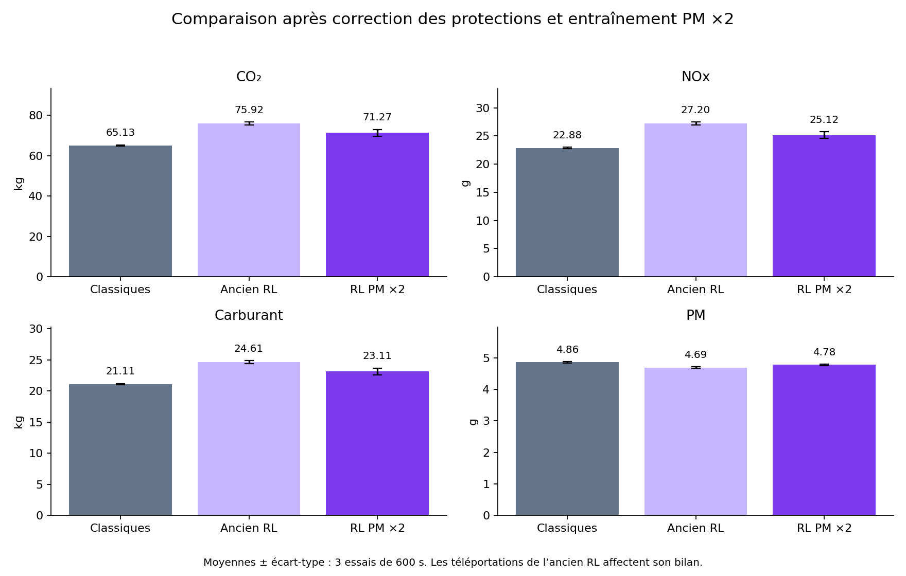

# FlowMind - Rapport explicatif
Étapes réalisées

Projet SUMO et agent RL d’émissions | 21 octobre 2026

Ce rapport explique le travail réalisé dans le projet local, depuis la collecte des métriques jusqu’au dernier entraînement. Il distingue les changements du programme, l’apprentissage du modèle et les résultats réellement mesurés.

## 1. Le but de notre travail

Nous cherchons à piloter les feux de circulation pour diminuer les émissions des véhicules et la consommation de carburant. Nous comparons les décisions de l’agent à une référence avec des feux classiques.

| Métrique | Ce que nous mesurons | Unité du bilan |
| --- | --- | --- |
| CO₂ | Émissions de dioxyde de carbone | kg |
| NOx | Émissions d’oxydes d’azote | g |
| Carburant | Masse de carburant consommée | kg |
| PM / PMx | Particules calculées par le modèle d’émissions de SUMO | g |

PM signifie Particulate Matter, c’est-à-dire particules. Dans cette étude, PMx désigne la sortie d’émissions du modèle SUMO ; ce n’est pas une mesure réelle de la qualité de l’air.

## Le parcours suivi

1. Préparer un scénario et une référence avec des feux classiques.

2. Collecter et enregistrer les résultats de SUMO.

3. Construire un dashboard de simulation et d’historique.

4. Ajouter un agent à règles Python, puis un agent RL avec un modèle.

5. Entraîner, valider et tester le RL sur des seeds distinctes.

6. Corriger les protections contre les attentes excessives et renforcer le poids des PM.

7. Réentraîner et comparer le modèle retenu aux feux classiques.

# Préparer les essais et collecter les données

## 2. Définir une simulation comparable

Les derniers essais utilisent le scénario 3x3grid : un réseau de neuf carrefours, avec deux phases vertes par carrefour. Le réseau routier et les trajets des véhicules sont décrits dans scenarios/.

Chaque test dure 600 secondes, soit dix minutes simulées. Le fichier de routes fourni fait partir 300 véhicules pendant cette fenêtre. Le nombre de véhicules vient ici du fichier de routes : il n’a pas été choisi librement dans le formulaire pour ces essais.

Une seed est un nombre qui fixe les choix aléatoires de la simulation. Pour une comparaison, les méthodes utilisent la même carte, le même fichier de trafic, la même durée et la même seed. Changer la seed ne crée pas automatiquement une nouvelle demande de trafic.

## 3. Construire la référence

Dans le dashboard, « sans agent » correspond au contrôleur fixed_time : il fait tourner les phases avec 30 secondes de vert par phase, plus les transitions. Il ne s’adapte pas aux émissions et n’utilise pas de modèle appris. Le programme Python reste connecté à SUMO pour exécuter ce contrôle et mesurer les résultats.

## 4. Récupérer les métriques de SUMO

Le programme utilise TraCI, l’interface qui permet à Python de lire SUMO et de commander les feux. Il récupère des mesures chaque seconde, y compris pendant les transitions jaune et rouge.

| Fichier d’un essai | Rôle |
| --- | --- |
| timeseries.csv | Mesures au fil du temps : émissions, attente, files, vitesse, etc. |
| tripinfo.xml | Bilan officiel SUMO par trajet, avec les émissions des trajets non terminés à la fin. |
| metadata.json | Conditions de l’expérience : contrôleur, durée, seed, configuration et empreintes. |
| decisions.csv | Phases demandées et appliquées, avec une explication de la décision. |
| result.json | Indicateurs finaux calculés pour comparer les essais. |

Les taux instantanés, en mg/s, servent aux courbes. Les totaux finaux, en kg ou en g, proviennent du bilan officiel tripinfo. Ce ne sont pas les mêmes types de valeurs.

# Visualiser et prendre des décisions

## 5. Créer le dashboard

Le dashboard est une interface dans le navigateur. La page Simulation permet de choisir une méthode, de lancer ou arrêter un essai et de suivre les mesures. La page Historique affiche une courbe par métrique sur une fenêtre de temps choisie.

Les trois méthodes sont : feux classiques, agent à règles Python et agent avec modèle RL. Les courbes permettent de sélectionner une méthode ou de les comparer. SUMO conserve sa propre fenêtre lorsqu’on choisit le mode graphique.

Changer la méthode pendant une simulation permet d’observer son comportement. Pour mesurer une amélioration de façon comparable, nous utilisons cependant des essais séparés : une méthode hérite sinon de l’état de circulation laissé par la précédente.

## 6. Développer l’agent à règles Python

rules.py contient des règles écrites à la main. Son score utilise uniquement le CO₂, les NOx, le carburant et les PM. Il compare leur charge normalisée sur les voies des différentes phases et donne une priorité réactive à une direction autorisée.

Cet agent n’apprend pas. Les files, l’attente et la saturation restent utilisées pour les protections de circulation, mais elles ne sont pas des termes de son score environnemental. Un score fondé sur les émissions actuelles ne prédit pas à lui seul l’effet futur d’un changement de feu.

## 7. Ajouter un agent RL

| Élément | Fonctionnement du modèle actuel |
| --- | --- |
| Entrée | Émissions par phase, phase actuelle et durée du vert pour les neuf carrefours. |
| Sortie | Une proposition de phase par carrefour. Un seul modèle centralisé produit ces neuf choix. |
| Protection | SafetyGate vérifie les durées, les directions en attente et les sorties saturées. |
| Action appliquée | SUMO exécute la phase retenue avec les transitions prévues. |

Le modèle utilise PPO, un algorithme d’apprentissage par renforcement. Ce n’est pas un LLM. Dans le dashboard, il applique ce qu’il a appris ; il ne modifie pas ses paramètres automatiquement pendant son utilisation.

# Entraîner, valider et sauvegarder

## 8. Comprendre une boucle d’apprentissage

1. SUMO fournit l’état de la circulation et les émissions.

2. Le modèle propose les phases des feux ; les protections filtrent les décisions.

3. SUMO avance et le programme mesure les émissions produites.

4. Une récompense est calculée : moins d’émissions correspond à une valeur moins négative.

5. Pendant l’entraînement seulement, PPO utilise ces expériences pour mettre à jour le modèle.

Un épisode est une simulation d’apprentissage. Une étape PPO correspond à une décision du modèle, pas à une seconde SUMO : les transitions font varier le temps simulé entre deux décisions.

Un checkpoint est une sauvegarde du modèle à un moment de l’entraînement. Nous comparons plusieurs sauvegardes pour choisir celle à utiliser ensuite.

## 9. Séparer les données selon leur rôle

| Jeu | Utilisation |
| --- | --- |
| Entraînement | Produire des expériences et modifier les paramètres du modèle. Seeds utilisées au fil de la lignée : 0 à 5. |
| Validation | Évaluer les checkpoints et choisir celui à conserver. Dernières validations : 1000 et 1001. |
| Test | Comparer sans apprentissage. Derniers tests : 10020, 10021, 10022, distincts de l’entraînement et de la validation. |

## 10. Les entraînements réalisés

| Version | Étapes exécutées au total | Checkpoint retenu | Objectif / évolution |
| --- | --- | --- | --- |
| Prototype | 128 | 128 | Vérifier le fonctionnement ; apprentissage très court. |
| Reprise V2 | 4 224 | 4 224 | 4 096 étapes ajoutées ; poids 1 / 1 / 1 / 1. |
| Reprise PM | 8 320 | 7 296 | 4 096 étapes ajoutées ; protections corrigées et PM ×2. |

Le dernier checkpoint n’est pas forcément le meilleur. Lors de la dernière session, celui de 7 296 étapes a été préféré à celui de 8 320 étapes sur la validation. 32 épisodes complets de dix minutes ont été terminés pendant cette session.

best.zip conserve le checkpoint retenu ; last.zip conserve le dernier état entraîné. manifest.json enregistre les poids, les protections, les seeds et les étapes. Les CSV du modèle conservent le suivi de l’apprentissage et de la validation.

# Corriger les blocages et renforcer les PM

## 11. Le problème constaté

L’ancien RL provoquait des téléportations : SUMO retirait temporairement des véhicules bloqués trop longtemps. Dans notre configuration, le seuil était de 60 secondes. Or la règle de priorité à une direction en attente pouvait intervenir après 90 secondes, trop tard pour ce seuil.

Sur les trois nouveaux essais de référence, l’ancien RL a produit 35 téléportations en moyenne. Ses émissions sont affectées par ces changements de présence des véhicules dans le réseau.

## 12. Les corrections réalisées

| Réglage du RL | Avant | Après |
| --- | --- | --- |
| Priorité à une direction en file au rouge | 90 s | 30 s |
| Vert maximal du RL | 60 s | 35 s |
| Vert minimal du RL | 10 s | 10 s |
| Seuil de téléportation SUMO | 60 s | 60 s, inchangé |
| Poids CO₂ / NOx / carburant / PM | 1 / 1 / 1 / 1 | 1 / 1 / 1 / 2 |

Une marge est gardée pour la prochaine décision, le jaune et la libération du carrefour. Les protections sont enregistrées avec le modèle et appliquées aussi à l’inférence. Le dashboard peut les renforcer, mais pas les relâcher au-delà des limites du modèle.

Le cycle des feux classiques reste à 30 secondes. Le seuil SUMO n’a pas été augmenté pour masquer les blocages. La priorité après 30 secondes concerne la mémoire de file d’une direction ; ce n’est pas une garantie sur le temps d’attente de chaque véhicule.

## 13. La nouvelle récompense

Les quatre quantités d’émissions sont normalisées pour rendre leurs échelles comparables. Le coût pondéré vaut : (CO₂ normalisé + NOx normalisé + carburant normalisé + 2 × PM normalisées) / 5. La récompense est l’opposé de ce coût.

Doubler le poids des PM les rend plus importantes dans l’objectif, sans garantir qu’elles baissent à chaque essai. Une moyenne pondérée accepte toujours des compromis entre les quatre métriques.

Pour retenir un checkpoint, nous minimisons d’abord les collisions, puis les téléportations, puis le coût environnemental. Le modèle protégé avant apprentissage a aussi été validé : cela distingue l’effet des protections de celui des nouvelles mises à jour.

# Comparer les résultats obtenus

Dernière comparaison : trois seeds (10020, 10021, 10022), 600 secondes et 300 véhicules partis par essai. Les valeurs sont les moyennes sur ces trois essais. Les conditions et les empreintes des fichiers sont enregistrées pour chaque expérience.

| Mesure | Classiques | RL corrigé | RL / classiques |
| --- | --- | --- | --- |
| CO₂ (kg) | 65.13 | 71.27 | +9.4 % |
| NOx (g) | 22.88 | 25.12 | +9.8 % |
| Carburant (kg) | 21.11 | 23.11 | +9.4 % |
| PM (g) | 4.86 | 4.78 | -1.8 % |
| Véhicules arrivés (véhicules) | 245.00 | 231.67 | -5.4 % |
| Téléportations (événements) | 0.00 | 0.00 | - |

Le RL corrigé n’a enregistré aucune collision ni téléportation sur les trois tests. Les PM sont inférieures de 1,8 % à celles des feux classiques. En revanche, CO₂, NOx et carburant restent supérieurs : il ne bat pas encore la référence globalement.

Les PM restent environ 1,9 % au-dessus de celles de l’ancien RL. Il faut lire cette différence avec les téléportations de l’ancienne version. La correction des protections et le nouvel entraînement ont été combinés ; tout le changement ne vient pas du seul poids des PM.

# Retrouver le code et poursuivre l’étude

| Emplacement | Rôle |
| --- | --- |
| scenarios/ | Réseaux routiers et demandes de trafic SUMO. |
| config.yaml | Réglages des simulations, règles et protections spécifiques au RL. |
| flowmind/contracts.py | Structure des états et mesures échangés dans le programme. |
| flowmind/env.py | Connexion SUMO / TraCI, mesures et transitions des feux. |
| flowmind/agents/rules.py | Agent à règles avec score environnemental et contraintes. |
| flowmind/emission_rl.py | Entrées du modèle, protections et utilisation du PPO sauvegardé. |
| scripts/train_emissions.py | Entraînement, reprise, validation et choix des checkpoints. |
| flowmind/evaluation.py scripts/evaluate.py | Exécution et enregistrement des expériences comparables. |
| flowmind/kpis.py | Calcul des indicateurs et des variations entre méthodes. |
| scripts/dashboard.py dashboard/index.html | Serveur local et interface Simulation / Historique. |
| runs/models/emission_ppo/ | Modèle actuellement actif. L’ancienne version est sauvegardée dans runs/models/emission_ppo_before_pm_v3_20261021/. |
| runs/reports/pm_rl_20261021/ | Dernier rapport, comparaison.csv, details.json et graphiques. |

## Ce qui est vérifié et ce qui reste à faire

Les 61 tests Python passent et la syntaxe JavaScript du dashboard a été vérifiée. L’absence de téléportation est confirmée sur les trois derniers essais ; elle ne garantit pas l’absence de blocage sur tous les trafics.

Le modèle reste un prototype : un seul scénario et trois seeds de test ne suffisent pas à prouver sa généralisation. Il faut encore étudier des demandes et durées variées, améliorer les décisions sans dégrader une métrique et valider un débit de véhicules comparable aux feux classiques.

Pour ouvrir le dashboard, lancer scripts/dashboard.py avec Python, puis consulter http://127.0.0.1:8501/simulation ou /history. Cette adresse fonctionne lorsque le serveur est lancé. Les métriques sont des mesures de simulation, pas des mesures réelles de pollution.

Sources du rapport : code local sur la branche manoubi ; manifest.json du modèle actif ; détails des trois campagnes dans runs/reports/evaluation_rl_20261021/, fine_tuning_rl_20261021/ et pm_rl_20261021/. Le dernier dossier contient les identifiants des neuf simulations de référence et de test.
